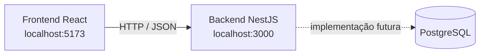
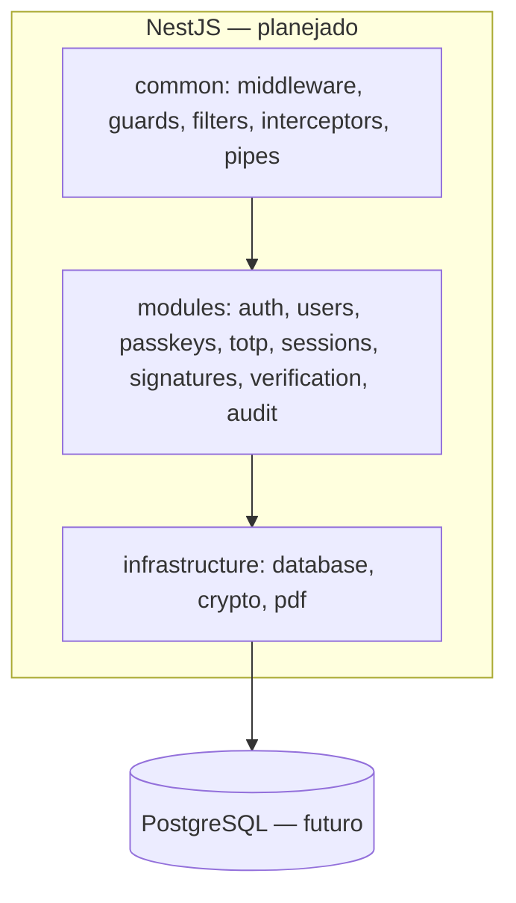

# Assinatura Digital — Backend

Backend independente da plataforma acadêmica de assinatura digital e verificação criptográfica de PDFs.

## RNF-01 — Backend e frontend desacoplados

Este repositório contém somente a API HTTP do backend. O frontend React/Vite/TypeScript está em seu próprio repositório: [assinaturaDigitalFront](https://github.com/matheusgvl/assinaturaDigitalFront). As aplicações não compartilham código, não usam monorepo ou submodules e se comunicam exclusivamente por HTTP/JSON.

O frontend não acessa PostgreSQL diretamente e o backend não importa componentes React. A URL da API deverá ser configurada futuramente no frontend por uma variável como `VITE_API_BASE_URL`, a confirmar no código do frontend.



## Tecnologias e pré-requisitos

- Node.js LTS e npm
- TypeScript
- NestJS
- Jest e Supertest

## Execução local

```bash
npm ci
npm run start:dev
```

O servidor inicia em `http://localhost:3000`. O backend não depende de o frontend estar instalado ou em execução.

Scripts disponíveis:

```bash
npm run start       # execução normal
npm run start:dev   # modo watch
npm run build       # compilação TypeScript
npm run lint        # ESLint
npm run test        # testes unitários
npm run test:e2e    # testes HTTP de integração
```

## Endpoint provisório

`GET /health` retorna HTTP 200 e:

```json
{
  "status": "ok",
  "service": "assinatura-digital-api"
}
```

É uma rota mínima, sem banco, credenciais, autenticação ou informações sobre serviços externos. O prefixo `/api/v1` será tratado posteriormente na Issue #81 (RNF-16); portanto, não é aplicado nesta issue.

## Estrutura implementada

```text
src/
├── main.ts                 # inicialização independente do servidor
├── app.module.ts           # composição do módulo principal
└── modules/
    └── health/
        ├── health.module.ts
        ├── health.controller.ts  # transporte HTTP
        ├── health.service.ts     # contrato/regra do health check
        └── health.service.spec.ts
test/
└── health.e2e-spec.ts      # contrato HTTP e rota inexistente
```

Controllers recebem requisições e delegam aos services. Services concentram regras de domínio e não conhecem a interface visual. A infraestrutura futura concentrará persistência, criptografia, PDFs e integrações externas. CORS, headers, rate limiting, CSRF, autenticação e tratamento padronizado de erros serão tratados nas issues próprias.

## Arquitetura planejada (não implementada nesta issue)



Essa estrutura é apenas o planejamento arquitetural. Não foram implementados nesta issue PostgreSQL, ORM, variáveis de ambiente, migrations, API REST completa, autenticação, criptografia, assinatura/verificação de PDFs, CORS completo ou deploy.

## Contratos REST

HTTP conventions, expected statuses, and the detailed health-check contract are documented in [`docs/API_REST.md`](docs/API_REST.md). The current endpoint is intentionally small; no fictitious user, document, or authentication endpoints are exposed.

## Configuração por ambiente

The current environment configuration is documented in [`docs/RNF-05-CONFIG.md`](docs/RNF-05-CONFIG.md). Only `PORT` is currently used; it defaults locally to `3000` when absent. Credentials and future database/authentication settings are not created in this issue.

## Processo de desenvolvimento

Cada requisito deve ser trabalhado em sua própria branch e issue, com commits terminados em `Ref #ID`, revisão por Pull Request e merge posterior na `main`. Esta entrega é exclusiva do RNF-01 / Issue #67 e não altera o repositório do frontend.

## Validação

Os comandos de lint, build, testes unitários, testes HTTP e execução independente devem ser executados antes da revisão do Pull Request. Resultados reais e eventuais limitações devem acompanhar a entrega; funcionalidades planejadas não são apresentadas como concluídas.
