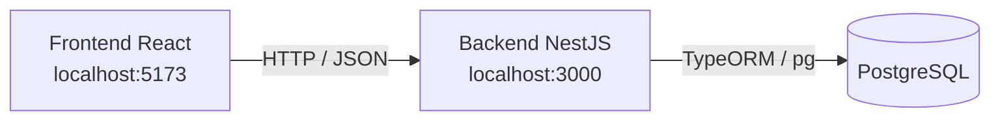

# Assinatura Digital — Backend

Backend independente da plataforma acadêmica de assinatura digital e verificação criptográfica de PDFs.

## RNF-01 — Backend e frontend desacoplados

Este repositório contém somente a API HTTP do backend. O frontend React/Vite/TypeScript está em seu próprio repositório: [assinaturaDigitalFront](https://github.com/matheusgvl/assinaturaDigitalFront). As aplicações não compartilham código, não usam monorepo ou submodules e se comunicam exclusivamente por HTTP/JSON.

O frontend não acessa PostgreSQL diretamente e o backend não importa componentes React. A URL da API deverá ser configurada futuramente no frontend por uma variável como `VITE_API_BASE_URL`, a confirmar no código do frontend.



## Tecnologias e pré-requisitos

- Node.js LTS e npm
- TypeScript
- NestJS
- PostgreSQL
- Jest e Supertest

## Execução local

```bash
npm ci
cp .env.example .env
npm run start:dev
```

Antes de iniciar, preencha `DATABASE_URL` no `.env` com a URL do PostgreSQL local autorizado. `DATABASE_SSL=false` é adequado somente para uma instância local controlada; conexões TLS devem usar `DATABASE_SSL=true` e manter a verificação do certificado. O servidor inicia em `http://localhost:3000` somente depois de validar a configuração e abrir a conexão PostgreSQL. O backend não depende de o frontend estar instalado ou em execução.

Scripts disponíveis:

```bash
npm run start       # execução normal
npm run start:dev   # modo watch
npm run build       # compilação TypeScript
npm run lint        # ESLint
npm run test        # testes unitários
npm run test:e2e    # testes HTTP de integração
```

## Endpoint provisório

`GET /health` retorna HTTP 200 e:

```json
{
  "status": "ok",
  "service": "assinatura-digital-api"
}
```

É uma rota mínima: não executa consultas, não expõe credenciais nem informações sobre serviços externos e permanece disponível após a conexão de infraestrutura ser estabelecida. O prefixo `/api/v1` será tratado posteriormente na Issue #81 (RNF-16); portanto, não é aplicado nesta issue.

## Estrutura implementada

```text
src/
├── main.ts                 # inicialização independente do servidor
├── app.module.ts           # composição do módulo principal
├── config/                  # validação de PORT e PostgreSQL
├── database/                # opções e módulo TypeORM
└── modules/
    └── health/
        ├── health.module.ts
        ├── health.controller.ts  # transporte HTTP
        ├── health.service.ts     # contrato/regra do health check
        └── health.service.spec.ts
test/
├── health.e2e-spec.ts       # contrato HTTP e rota inexistente
└── database.e2e-spec.ts     # conexão, falhas de startup e encerramento do pool
```

Controllers recebem requisições e delegam aos services. Services concentram regras de domínio e não conhecem a interface visual. A infraestrutura PostgreSQL é criada pelo `DatabaseModule`, que recebe opções somente do `ConfigService` e não registra URLs ou credenciais. CORS, headers, rate limiting, CSRF, autenticação e tratamento padronizado de erros serão tratados nas issues próprias.

## Arquitetura de persistência


O RNF-04 implementa a conexão de infraestrutura com PostgreSQL usando `@nestjs/typeorm`, TypeORM e `pg`. PDFs não são armazenados no banco nesta etapa. Entidades, migrations e o modelo de domínio pertencem às issues futuras #74–#76; por isso, esta implementação não executa migrations automaticamente e não habilita `synchronize`.

## Contratos REST

HTTP conventions, expected statuses, and the detailed health-check contract are documented in [`docs/API_REST.md`](docs/API_REST.md). The current endpoint is intentionally small; no fictitious user, document, or authentication endpoints are exposed.

## Configuração por ambiente

The current environment configuration is documented in [`docs/RNF-05-CONFIG.md`](docs/RNF-05-CONFIG.md). `PORT` and `DATABASE_URL` are required at startup; `PORT` must be an integer between `1` and `65535`, and `DATABASE_URL` must be a PostgreSQL URL. `DATABASE_SSL` accepts only `true` or `false` and defaults to `false` for local development.

## Arquivo `.env.example`

O arquivo versionado [`.env.example`](.env.example) documenta `PORT`, `DATABASE_URL` e `DATABASE_SSL`, sem credenciais reais. Para configurar uma cópia local somente quando ainda não existir um `.env`:

```bash
cp .env.example .env
```

```powershell
Copy-Item .env.example .env
```

O `.env.example` serve como referência compartilhada; o `.env` contém a configuração local e não deve ser versionado. `PORT` e `DATABASE_URL` devem ser válidos antes da inicialização; valores ausentes ou inválidos fazem o backend recusar o startup. Sempre que uma funcionalidade introduzir uma nova variável, a mesma branch deve atualizar o exemplo e a documentação correspondente, sem inserir valores reais.

A auditoria sanitizada de proteção e histórico está registrada em [`docs/RNF-07-AUDIT.md`](docs/RNF-07-AUDIT.md). O `.env.example` é a única exceção permitida ao padrão de ignorar arquivos de ambiente.

A validação obrigatória na inicialização está documentada em [`docs/RNF-08-VALIDATION.md`](docs/RNF-08-VALIDATION.md).

A arquitetura, as opções de conexão e as evidências de integração do PostgreSQL estão documentadas em [`docs/RNF-04-DATABASE.md`](docs/RNF-04-DATABASE.md).

## Processo de desenvolvimento

Cada requisito deve ser trabalhado em sua própria branch e issue, com commits terminados em `Ref #ID`, revisão por Pull Request e merge posterior na `main`. O backend e o frontend permanecem em repositórios independentes.

## Validação

Os comandos de lint, build, testes unitários, testes HTTP e execução independente devem ser executados antes da revisão do Pull Request. Resultados reais e eventuais limitações devem acompanhar a entrega; funcionalidades planejadas não são apresentadas como concluídas.
