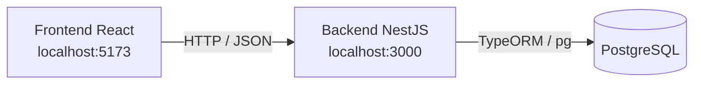

# Assinatura Digital — Backend

Backend independente da plataforma acadêmica de assinatura digital e verificação criptográfica de PDFs.

## RNF-01 — Backend e frontend desacoplados

Este repositório contém somente a API HTTP do backend. O frontend React/Vite/TypeScript está em seu próprio repositório: [assinaturaDigitalFront](https://github.com/matheusgvl/assinaturaDigitalFront). As aplicações não compartilham código, não usam monorepo ou submodules e se comunicam exclusivamente por HTTP/JSON.

O frontend não acessa PostgreSQL diretamente e o backend não importa componentes React. A URL da API deverá ser configurada futuramente no frontend por uma variável como `VITE_API_BASE_URL`, a confirmar no código do frontend.



## Tecnologias e pré-requisitos

- Node.js LTS e npm
- TypeScript
- NestJS
- PostgreSQL
- Jest e Supertest

## Execução local

```bash
npm ci
test -f .env || cp .env.example .env
npm run start:dev
```

Antes de iniciar, preencha `DATABASE_URL` no `.env` com a URL do PostgreSQL local autorizado. `DATABASE_SSL=false` é adequado somente para uma instância local controlada; conexões TLS devem usar `DATABASE_SSL=true` e manter a verificação do certificado. O servidor inicia em `http://localhost:3000` somente depois de validar a configuração e abrir a conexão PostgreSQL. O backend não depende de o frontend estar instalado ou em execução.

Scripts disponíveis:

```bash
npm run start       # execução normal
npm run start:dev   # modo watch
npm run build       # compilação TypeScript
npm run lint        # ESLint
npm run test        # testes unitários
npm run test:e2e    # testes HTTP de integração
npm run migration:show
npm run migration:run
```

## Endpoint provisório

`GET /api/v1/health` retorna HTTP 200 e:

```json
{
  "status": "ok",
  "service": "assinatura-digital-api"
}
```

É uma rota mínima: não executa consultas, não expõe credenciais nem informações sobre serviços externos e permanece disponível após a conexão de infraestrutura ser estabelecida. Todas as rotas HTTP são expostas sob o prefixo versionado `/api/v1`, conforme a Issue #81 (RNF-16).

## Estrutura implementada

```text
src/
├── main.ts                 # inicialização independente do servidor
├── app.module.ts           # composição do módulo principal
├── config/                  # validação de PORT e PostgreSQL
├── database/                # opções, módulo e DataSource TypeORM
│   └── migrations/          # migrations de produção versionadas
└── modules/
    └── health/
        ├── health.module.ts
        ├── health.controller.ts  # transporte HTTP
        ├── health.service.ts     # contrato/regra do health check
        └── health.service.spec.ts
test/
├── health.e2e-spec.ts       # contrato HTTP e rota inexistente
├── database.e2e-spec.ts      # conexão, falhas de startup e encerramento do pool
└── migrations.e2e-spec.ts    # criação e histórico da fixture PostgreSQL
```

Controllers recebem requisições e delegam aos services. Services concentram regras de domínio e não conhecem a interface visual. A infraestrutura PostgreSQL é criada pelo `DatabaseModule`, que recebe opções somente do `ConfigService` e não registra URLs ou credenciais. CORS, headers, rate limiting, autenticação, CSRF para as rotas de refresh/logout e tratamento padronizado de erros estão implementados; TOTP completo e passkeys continuam em issues próprias.

## Arquitetura de persistência


O RNF-04 implementa a conexão de infraestrutura com PostgreSQL usando `@nestjs/typeorm`, TypeORM e `pg`. O RNF-09 adiciona o `DataSource` compartilhado e o mecanismo de migrations versionadas. A autenticação, as chaves de assinatura cifradas e os metadados das assinaturas são persistidos no banco; os bytes dos PDFs permanecem somente em memória durante o processamento.

## Migrations versionadas

O fluxo de migrations, a fixture de homologação, os comandos da CLI e as evidências reais estão documentados em [`docs/RNF-09-MIGRATIONS.md`](docs/RNF-09-MIGRATIONS.md). A aplicação mantém `synchronize`, `migrationsRun` e `dropSchema` desativados; migrations são executadas somente por comando explícito.

## Contratos REST

HTTP conventions, expected statuses, and the detailed contracts are documented in [`docs/API_REST.md`](docs/API_REST.md). O backend expõe health check, autenticação, assinatura autenticada e verificação pública de PDFs.

## Configuração por ambiente

The current environment configuration is documented in [`docs/RNF-05-CONFIG.md`](docs/RNF-05-CONFIG.md). `PORT`, `DATABASE_URL`, RSA JWT keys and `PDF_MASTER_KEY_B64` are required at startup; `PORT` must be an integer between `1` and `65535`, and `DATABASE_URL` must be a PostgreSQL URL. `DATABASE_SSL` accepts only `true` or `false` and defaults to `false` for local development.

## Arquivo `.env.example`

O arquivo versionado [`.env.example`](.env.example) documenta todas as variáveis sem credenciais reais, incluindo as chaves JWT e a chave mestra de cifragem das chaves de assinatura. Para configurar uma cópia local somente quando ainda não existir um `.env`:

```bash
test -f .env || cp .env.example .env
```

```powershell
if (-not (Test-Path .env)) {
  Copy-Item .env.example .env
}
```

O `.env.example` serve como referência compartilhada; o `.env` contém a configuração local e não deve ser versionado. `PORT` e `DATABASE_URL` devem ser válidos antes da inicialização; valores ausentes ou inválidos fazem o backend recusar o startup. Sempre que uma funcionalidade introduzir uma nova variável, a mesma branch deve atualizar o exemplo e a documentação correspondente, sem inserir valores reais.

A auditoria sanitizada de proteção e histórico está registrada em [`docs/RNF-07-AUDIT.md`](docs/RNF-07-AUDIT.md). O `.env.example` é a única exceção permitida ao padrão de ignorar arquivos de ambiente.

A validação obrigatória na inicialização está documentada em [`docs/RNF-08-VALIDATION.md`](docs/RNF-08-VALIDATION.md). A allowlist CORS explícita usa `CORS_ORIGINS`; o backend rejeita `*` e origens que não sejam URLs HTTP/HTTPS completas. As respostas também incluem CSP restritiva com `default-src 'self'`, `script-src 'self'`, `object-src 'none'` e `frame-ancestors 'none'`.

As rotas `POST /api/v1/auth/refresh` e `POST /api/v1/auth/logout` usam refresh token em cookie HttpOnly com `SameSite=Strict` e proteção CSRF por double submit. O login emite `csrf_token` (legível pelo frontend); o cliente deve reenviá-lo no cabeçalho `X-CSRF-Token`. O refresh gira os dois cookies. Rotas autenticadas por Bearer e a verificação pública de PDF não dependem desse cookie.

A arquitetura, as opções de conexão e as evidências de integração do PostgreSQL estão documentadas em [`docs/RNF-04-DATABASE.md`](docs/RNF-04-DATABASE.md).

A auditoria automatizada de dependências e a limitação atualmente observada no grafo npm estão em [`docs/REQ-66-DEPENDENCY-AUDIT.md`](docs/REQ-66-DEPENDENCY-AUDIT.md).

A política que proíbe alterações manuais permanentes no schema está em [`docs/RNF-10-MIGRATION-DISCIPLINE.md`](docs/RNF-10-MIGRATION-DISCIPLINE.md).

A convenção de timestamps, operações `up`/`down` e evidências de rollback está em [`docs/RNF-11-MIGRATION-IDENTIFIERS.md`](docs/RNF-11-MIGRATION-IDENTIFIERS.md).

A política de senhas do domínio está em [`docs/REQ-01-PASSWORD-POLICY.md`](docs/REQ-01-PASSWORD-POLICY.md).

O armazenamento de credenciais com Argon2id está em [`docs/REQ-02-ARGON2ID.md`](docs/REQ-02-ARGON2ID.md).

O contrato de cadastro, login, sessões, refresh rotacionado e logout está em [`docs/REQ-03-AUTHENTICATION-CORE.md`](docs/REQ-03-AUTHENTICATION-CORE.md).

A listagem e revogação de sessões ativas estão disponíveis em `GET /api/v1/auth/sessions`, `DELETE /api/v1/auth/sessions/:id` e `POST /api/v1/auth/sessions/revoke-all`; cada operação é filtrada pelo usuário autenticado.

O fluxo de assinatura criptográfica e a política de armazenamento das chaves estão em [`docs/REQ-46-PDF-SIGNATURE.md`](docs/REQ-46-PDF-SIGNATURE.md). A verificação pública do CMS embutido está em [`docs/REQ-50-PDF-VERIFICATION.md`](docs/REQ-50-PDF-VERIFICATION.md).

A política de compatibilidade, depreciação e criação de novas versões está em [`docs/RNF-17-API-VERSIONING.md`](docs/RNF-17-API-VERSIONING.md).

## Processo de desenvolvimento

Cada requisito deve ser trabalhado em sua própria branch e issue, com commits terminados em `Ref #ID`, revisão por Pull Request e merge posterior na `main`. O backend e o frontend permanecem em repositórios independentes.

## Validação

Os comandos de lint, build, testes unitários, testes HTTP e execução independente devem ser executados antes da revisão do Pull Request. Resultados reais e eventuais limitações devem acompanhar a entrega; funcionalidades planejadas não são apresentadas como concluídas.
